<p align="center">
  
</p>

<p align="center"><i>Práctica de Tecnologías de Cliente — Sistema de gestión de biblioteca</i></p>

<p align="center">
  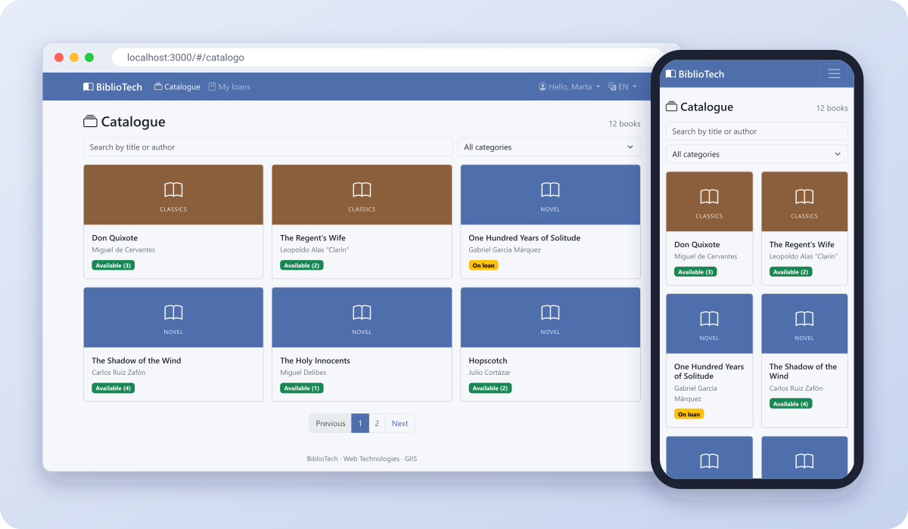
</p>

<p align="center">
  <br/>
  
  
  
  
  
</p>

<p align="center">
  <br/>
  
  
  
  
  
  
  
</p>

<p align="center">
  
</p>

<p align="center">
  <a href="#capturas-de-pantalla"></a>
  <a href="#mapa-de-navegación"></a>
  <a href="#arquitectura"></a>
  <a href="#instalación-y-puesta-en-marcha"></a>
  <a href="#pruebas"></a>
  <a href="#integración-continua"></a>
</p>

## Equipo TEW1-01

- [Cristian Augusto](https://github.com/augustocristian) - UO237600@uniovi.es
- [Diego Martin Fernandez](https://github.com/DiegoMfer) - martinfdiego@uniovi.es

## Índice

- [Descripción del proyecto](#descripción-del-proyecto)
- [Capturas de pantalla](#capturas-de-pantalla)
- [Estructura del proyecto](#estructura-del-proyecto)
- [Mapa de navegación](#mapa-de-navegación)
- [Arquitectura](#arquitectura)
- [Requisitos previos](#requisitos-previos)
- [Instalación y puesta en marcha](#instalación-y-puesta-en-marcha)
- [Pruebas](#pruebas)
- [Integración continua](#integración-continua)
- [Decisiones de implementación](#decisiones-de-implementación)
- [Licencia](#licencia)

## Descripción del proyecto

> ⚠️ Este README es un **ejemplo** de plantilla para la parte de cliente de la práctica. El mapa de navegación y
> las decisiones que se muestran a continuación son **ficticios**, pensados solo para ilustrar cómo documentar
> estas secciones. Cada equipo debe sustituirlos por los reales de su propio proyecto.

**BiblioTech Web** es la aplicación cliente de BiblioTech: una SPA construida con **HTML5, CSS3 y TypeScript
puro** (sin frameworks de UI) que consume la API REST expuesta por el [backend](README-backend.md) (a través de
su BFF) para que usuarios, bibliotecarios y administradores gestionen el catálogo, los préstamos y los usuarios
desde el navegador.

- **Login y registro**, con la sesión (JWT) guardada en el cliente.
- **Consulta del catálogo**, con búsqueda, filtros por categoría y paginación.
- **Gestión de préstamos**: solicitar un préstamo y consultar el historial propio.
- **Panel de bibliotecario**: gestión de ejemplares e incidencias.
- **Panel de administración**: gestión de usuarios y categorías, reservado al rol `ADMIN`.
- **Selector de idioma** (es/en), con los textos cargados en tiempo de ejecución.
- **Modo sin conexión**: la aplicación instalable (PWA) sigue mostrando el catálogo ya visitado sin red.
- **Vistas adaptadas por rol**: cada perfil (`USUARIO`, `BIBLIOTECARIO`, `ADMIN`) ve solo las pantallas que le
  corresponden.

## Capturas de pantalla

> ⚠️ Capturas **de ejemplo** de una aplicación de demostración. Cada equipo debe sustituirlas por las de su propia
> aplicación, mostrando siempre la versión de **escritorio** (izquierda) y la de **móvil** (derecha). Se recomienda
> exportarlas en **SVG** (vectorial): se ven nítidas a cualquier tamaño y pesan poco.
>
> 💡 **No hace falta incluir una captura de todas las funcionalidades**: basta con **2-4 de las más atractivas**
> (además de la pantalla principal del inicio). Aquí se muestran 5 solo a modo de ejemplo.
>
> 🛠️ En la carpeta [`src/`](../src/) se muestra el código con el que se han sacado estas capturas (Chrome →
> PDF → SVG). Es solo de referencia: puedes adaptarlo a tu aplicación o usar cualquier otra herramienta.

<p align="center">
  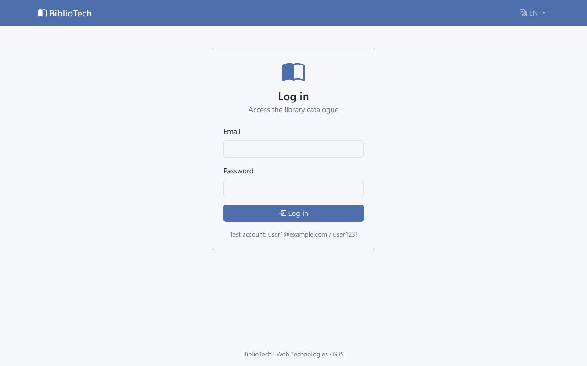
  &nbsp;
  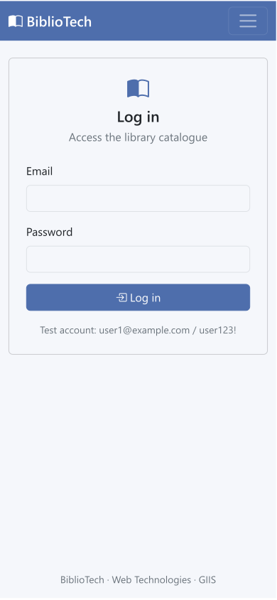
  <br/>
  <em><b>Figura 1 · Inicio de sesión.</b> Formulario de acceso contra el servicio de autenticación: si las
  credenciales son válidas guarda el JWT y redirige al catálogo; si no, muestra el error en el propio formulario.</em>
</p>

<p align="center">
  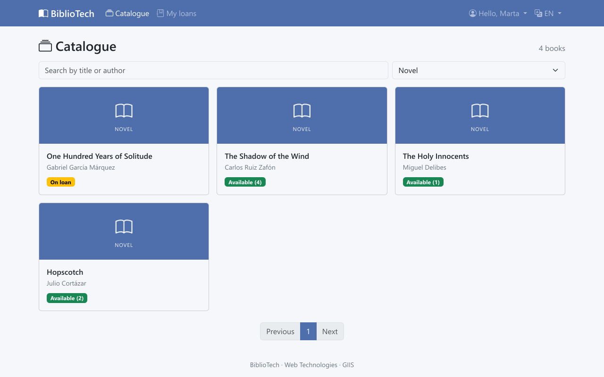
  &nbsp;
  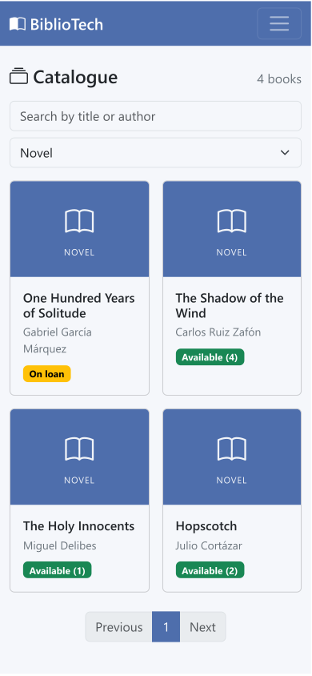
  <br/>
  <em><b>Figura 2 · Catálogo con búsqueda y filtros.</b> Listado paginado de libros con búsqueda por título o autor
  y filtro por categoría (aquí, "Novel"). La insignia de cada tarjeta indica si quedan ejemplares disponibles.</em>
</p>

<p align="center">
  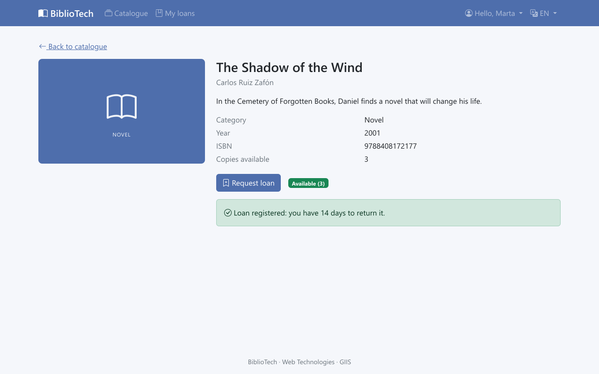
  &nbsp;
  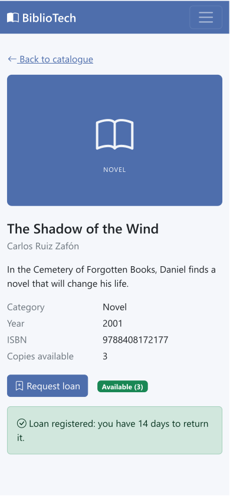
  <br/>
  <em><b>Figura 3 · Detalle y solicitud de préstamo.</b> Ficha del libro con su disponibilidad. Al pulsar
  "Request loan" se llama a la API, se confirma la operación y se actualizan los ejemplares disponibles.</em>
</p>

<p align="center">
  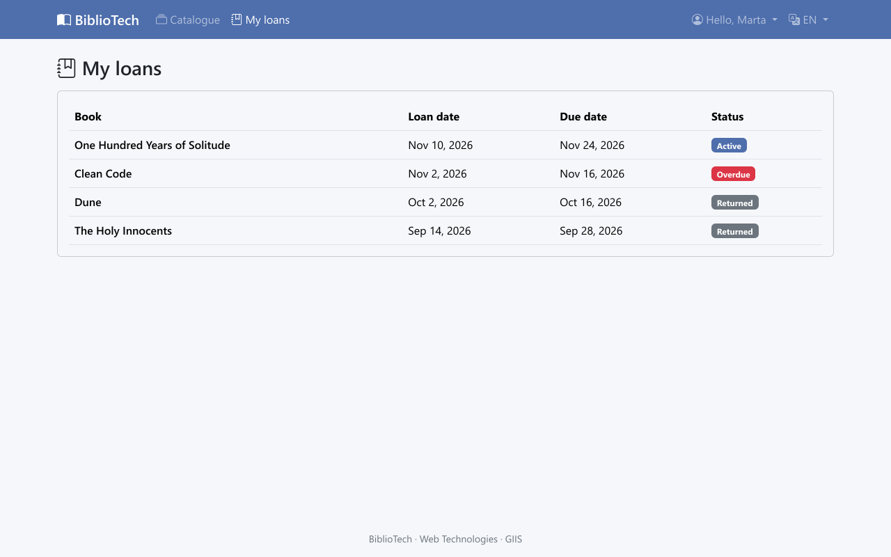
  &nbsp;
  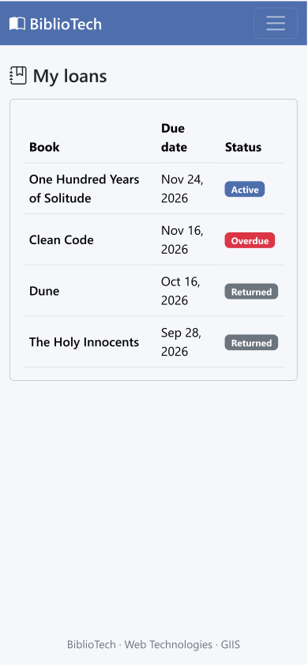
  <br/>
  <em><b>Figura 4 · Mis préstamos.</b> Historial del usuario autenticado con la fecha de devolución y el estado de
  cada préstamo (activo, retrasado o devuelto). En móvil se ocultan las columnas secundarias.</em>
</p>

<p align="center">
  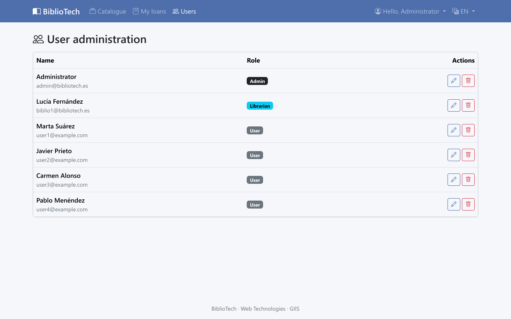
  &nbsp;
  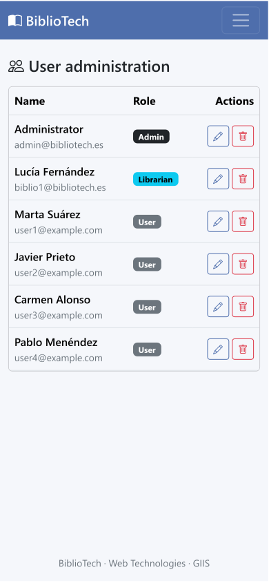
  <br/>
  <em><b>Figura 5 · Administración de usuarios.</b> Vista reservada al rol <code>ADMIN</code> (el menú "Users"
  solo aparece para ese rol): listado de usuarios con su rol y acciones de edición y baja.</em>
</p>

## Estructura del proyecto

> Las pruebas de sistema **no** viven dentro de este proyecto: son un directorio Java/Maven aparte,
> [`bibliotech-webtest/`](#pruebas), hermano de `bibliotech-web/` (y del resto de servicios del backend).

```
📁 bibliotech-web/
├── 📁 src/                  # TypeScript, compilado con tsc (sin bundler)
│   ├── 📁 api/
│   ├── 📁 vistas/
│   ├── 📁 componentes/
│   ├── 📁 router/
│   └── 📁 i18n/
├── 📁 css/
├── 📄 index.html
├── 📄 manifest.json
├── 📄 sw.js
├── 📄 server.mjs
├── 📄 tsconfig.json
└── 📄 package.json

📁 bibliotech-webtest/        # Directorio Java/Maven clásico, aparte, con las pruebas de sistema
├── 📁 src/test/java/es/uniovi/bibliotech/webtest/
└── 📄 pom.xml
```

- 📁 `api/` — Funciones `fetch` tipadas hacia el BFF (`bibliotech-bff`) y hacia `bibliotech-auth`
- 📁 `vistas/` — Una función de render por pantalla (Catálogo, Detalle de libro, Mis préstamos, Perfil, Admin...)
- 📁 `componentes/` — Snippets reutilizables clonados a partir de `<template>` (tarjetas, filas, modales)
- 📁 `router/` — Navegación por `hash` (`#/catalogo`, `#/mis-prestamos`...) sin librerías externas
- 📁 `i18n/` — Recursos de traducción (`es.json`, `en.json`) cargados con `fetch`
- 📄 `index.html` — Única página HTML de la SPA (plantilla base: cabecera, navegación, zona de contenido)
- 📄 `manifest.json` — Ficha de la PWA (nombre, iconos, cómo se abre)
- 📄 `sw.js` — *Service worker*: cachea el *shell* y los recursos de i18n, deja pasar las escrituras a la API
- 📄 `server.mjs` — Servidor Node que sirve los estáticos y hace de *proxy* inverso de `/api/*` hacia el backend
- 📄 `tsconfig.json` — Configuración del compilador TypeScript (`tsc`)
- 📄 `bibliotech-webtest/` — Proyecto Maven independiente (JUnit + Selenium WebDriver) con las pruebas de sistema

## Mapa de navegación

Diagrama de navegación **de ejemplo** entre las pantallas de la aplicación:

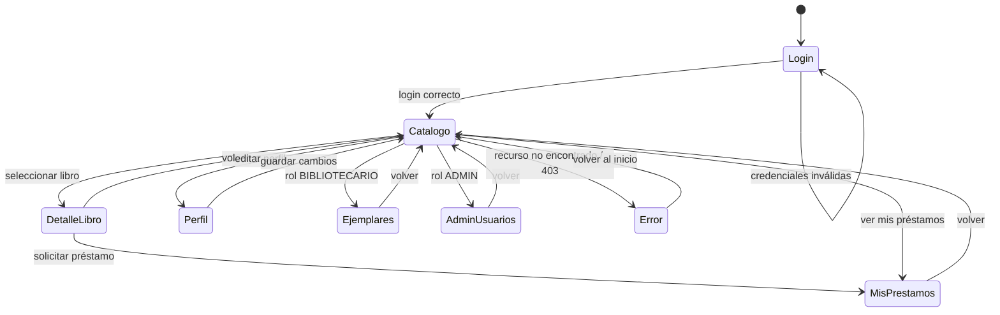

Cada estado es una vista renderizada dentro del mismo `index.html` (no hay recarga de página); el
`router/` interno cambia de vista al detectar un cambio en `location.hash` y actualiza la zona de contenido de la
plantilla base con el snippet correspondiente.

## Arquitectura

Diagrama de arquitectura **de ejemplo**: la SPA se compila a JavaScript estático y la sirve un pequeño servidor
Node, que además actúa de *proxy* inverso hacia el BFF del [backend](README-backend.md) para evitar problemas de
CORS; el login se resuelve aparte, directamente contra el servicio de autenticación.

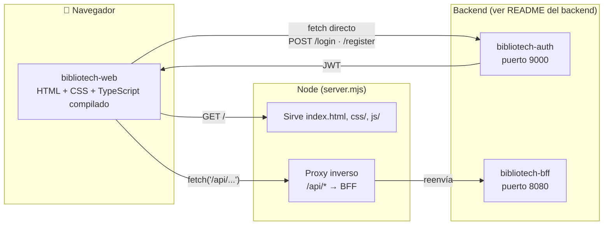

## Requisitos previos

> 🔗 Estos requisitos **complementan** a los del backend, no los sustituyen: consulta también los
> [Requisitos previos del backend](README-backend.md#requisitos-previos). Para esta entrega, el
> [README del backend](README-backend.md) debería **ampliarse** con las secciones oportunas (Docker Compose,
> perfil `prod` con PostgreSQL...); aquí solo se destacan, a modo de referencia, las partes que afectan
> directamente al cliente.

| Herramienta | Versión | Necesaria para |
|---|---|---|
| Node.js | 20+ | Compilar TypeScript (`tsc`) y ejecutar `server.mjs` |
| JDK + Maven | 21+ / 3.9+ | Ejecutar las pruebas de sistema (`bibliotech-webtest/`, Selenium WebDriver) |
| Navegador + *driver* de Selenium | — | Ejecutar las pruebas E2E (p. ej. ChromeDriver) |
| Backend de BiblioTech | — | La SPA necesita el BFF y el servicio de autenticación arrancados: en local, perfil `dev` (H2); en CI, con Docker Compose y perfil `prod` (PostgreSQL) — ver [README del backend](README-backend.md) |

### Variables de entorno

| Variable | Usada por | Ejemplo (dev) | Descripción |
|---|---|---|---|
| `PORT` | `server.mjs` | `3000` | Puerto en el que Node sirve la SPA |
| `API_PROXY_TARGET` | `server.mjs` | `http://localhost:8080` | URL del BFF al que se reenvía `/api/*` |
| `AUTH_URL` | Cliente (`config.json` servido por Node) | `http://localhost:9000` | URL del servicio de autenticación para el login |

## Instalación y puesta en marcha

> 🔗 Estos pasos **se integran** con los del backend: arranca primero el backend siguiendo su
> [Instalación y puesta en marcha](README-backend.md#instalación-y-puesta-en-marcha) y, después, la SPA con lo
> siguiente. De nuevo, el README del backend es quien debe documentar en detalle su propia puesta en marcha
> (incluida la variante con Docker Compose de esta entrega); aquí no se repite, solo se enlaza.

```bash
git clone https://github.com/usuario/bibliotech-web.git
cd bibliotech-web

npm install
npx tsc              # compila src/**/*.ts a js/**/*.js (sin bundler)
node server.mjs       # sirve los estaticos y expone el proxy /api/*
```

La aplicación queda disponible en `http://localhost:3000`. Necesita el backend (BFF + auth) arrancado en paralelo
(ver [Instalación del backend](README-backend.md#instalación-y-puesta-en-marcha)).

## Pruebas

Las pruebas de sistema viven en `bibliotech-webtest/`: un proyecto Java/Maven clásico y **aparte** (hermano de
`bibliotech-web/`, no un subdirectorio suyo), escrito con **JUnit + Selenium WebDriver** (sin Cucumber ni BDD).

```bash
cd bibliotech-webtest
mvn verify -Pe2e
```

Cada historia de usuario del [mapa de navegación](#mapa-de-navegación) tiene su propia clase `*SystemTest.java`
en `es.uniovi.bibliotech.webtest`, que abre un navegador real (o *headless*) con Selenium WebDriver y comprueba
el flujo completo contra la aplicación ya arrancada (cliente + backend). Al igual que en el backend, las pruebas
están desactivadas por defecto (`skipTests`) y solo se ejecutan con el perfil Maven `e2e`, porque necesitan todo
el stack levantado.

## Integración continua

El workflow de GitHub Actions (`.github/workflows/ci.yml`) se ejecuta en cada *push*/PR a `main` y:

1. Instala dependencias y ejecuta `npx tsc --noEmit` para comprobar que el proyecto tipa correctamente.
2. Levanta el backend con **Docker Compose** (perfil `prod`, con **PostgreSQL** en vez del H2 en memoria que se
   usa en local) y la SPA, y ejecuta `mvn verify -Pe2e` en `bibliotech-webtest/` contra un navegador *headless*.
3. Publica el informe de Surefire como *artifact* de la ejecución.

## Decisiones de implementación

> Solo se recogen las decisiones que **difieren de lo visto en clase**. El resto (TypeScript sin framework,
> Bootstrap 5 por CDN, `i18n` a mano con ficheros JSON, `<template>` para clonar filas, Node como servidor estático
> y *proxy* de `/api/*`) sigue tal cual lo explicado en el demostrador y no se repite.

### 1. Una SPA con *router* por `hash` en vez de vistas parciales

En clase cada pantalla se carga como un fragmento HTML (`fetch` de un *snippet*) dentro de `<main>`, y la navegación
la dispara cada botón. Aquí hay más de cinco pantallas con enlaces profundos (`#/libro/42`), así que se añade un
*router* mínimo sobre `location.hash`: una tabla `ruta → función de render`, sin librerías y sin necesidad de que
el servidor conozca las rutas (con `history.pushState` habría que reescribir todas a `index.html`). A cambio, el
botón "atrás" y los enlaces compartidos funcionan sin código extra.

### 2. Vistas por rol: el cliente oculta, el backend decide

El menú y el *router* ocultan las pantallas que no corresponden al rol (`USUARIO`, `BIBLIOTECARIO`, `ADMIN`), leído
del *claim* `roles` del JWT. Es solo comodidad de interfaz: el token se puede manipular desde las herramientas del
navegador, así que la seguridad real la aplica el backend (`403`). Si llega un `401` o un `403` desde la API, el
cliente cierra la sesión o muestra la vista de error, respectivamente.

### 3. Sesión en `localStorage`

El JWT se guarda en `localStorage` y se envía en `Authorization: Bearer` desde una única función `fetch` envuelta.
Es lo más simple y sobrevive a recargas, pero queda expuesto si hay un fallo XSS; la alternativa (cookie
`HttpOnly`) obligaría a que `auth` y el *proxy* gestionen cookies y protección CSRF, algo fuera del alcance de la
práctica. Por eso los textos se insertan siempre con `textContent` (nunca `innerHTML`) y no se cargan *scripts*
de terceros salvo Bootstrap, con `integrity`.

### 4. *Service worker* manual para el modo sin conexión

La PWA se escribe a mano (`manifest.json` + `sw.js`) en vez de con un plugin. Se cachea en `cache-first` el *shell*
(`index.html`, CSS, JS) y los ficheros de i18n, que cambian poco; las lecturas de la API usan `network-first` con
copia de respaldo (para mostrar el catálogo ya visitado sin red) y las escrituras (`POST /api/prestamos`) van
**siempre a red**: servir una escritura desde caché la duplicaría o devolvería una respuesta obsoleta.

## Licencia

Este proyecto de ejemplo se distribuye bajo licencia [MIT](https://opensource.org/licenses/MIT).

---

<p align="center">
  
  &nbsp;Tecnologías Web - Grado en Ingeniería Informática de Tecnologías de la Información
</p>
